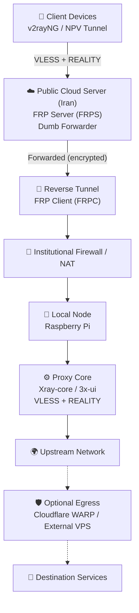

**English** | [فارسی](./README.fa.md)

# UniVPN — Secure Multi-Layer Network Bridge

<p align="center">
  
  
  
  
  
</p>

**Architecture, Concepts & Implementation Guide**

---

## About This Document

This repository does not contain ready-to-run code or a one-command deployment package. It is a **Reference Architecture** and a **phase-by-phase implementation guide** for bridging a network securely through a multi-layer communication path.

The purpose of this document is to provide the concept, design rationale, and a practical implementation path so that developers can adapt, replace, or improve any of the phases based on their own hardware, network requirements, and constraints.

> **Important:** UniVPN is an architectural reference, not an automated deployment tool. There is no universal configuration that works in every network environment. The implementer is responsible for adapting each layer to the target environment and for complying with the policies of their network and organization.

---

## Project Objectives

### Technical Objectives

1. **Remote access without a public IP**: Provide connectivity to a local network without requiring a public IP address at the local endpoint.
2. **Overcome NAT and firewalls**: Use reverse tunneling to bypass inbound connection restrictions.
3. **Separation of responsibilities**: Separate traffic forwarding from proxy processing.
4. **Keep the proxy core on the local node**: The Xray proxy session — including VLESS authentication and REALITY security processing — terminates on the local device. The public relay server forwards the encrypted proxy stream without terminating the inner Xray session.
5. **End-to-end security**: Independent encryption and authentication at every layer.
6. **Hardware adaptability**: Run on low-power devices such as Raspberry Pi and other Linux-based machines.
7. **Optional upstream routing**: Allow an alternative egress layer (Cloudflare WARP or external VPS) when required.

### Use Case Context

This architecture is designed for environments where:

- Local devices operate behind NAT, an institutional firewall, or a captive portal.
- External users cannot establish direct connections to devices inside the local network.
- There is a need to share a secure upstream network connection with authorized users.

---

## Design Principles

UniVPN is built on four architectural principles:

### 1. Separation of Responsibilities

Each infrastructure component has a defined role. The public server only forwards; the local node performs proxy processing. This separation keeps the relay lightweight and moves the cryptographic workload to the local device. The FRP relay can still observe connection metadata such as IP addresses, ports, and traffic volume, but it does not terminate the inner Xray session.

### 2. Modularity

The architecture is divided into independent layers. Each layer can be removed, replaced, or extended without redesigning the entire system. For example, FRP can be swapped for WireGuard (when UDP connectivity and routing configuration are available), or WARP can be replaced by an external VPS.

### 3. Resource Efficiency

A low-power device such as a Raspberry Pi can act as the local gateway and proxy host without requiring a dedicated high-performance server.

### 4. Adaptability

The design can be adjusted for different network environments, routing requirements, and hardware capabilities.

---

## Architecture and Network Components

### High-Level Diagram



> **Note:** The WARP / external VPS stage is optional (dashed line). The exact egress path depends on the selected configuration.

### Components and Roles

| Component | Role | Location |
|---|---|---|
| Raspberry Pi | Local network gateway and proxy host | Inside the organizational network |
| FRP Server (FRPS) | Public entry point and forwarder | Public cloud server |
| FRP Client (FRPC) | Establishes the reverse tunnel to the cloud server | Raspberry Pi |
| Xray-core | Proxy processing, authentication, routing | Raspberry Pi |
| VLESS + REALITY (with optional XTLS Vision flow) | Client-facing connection protocol and transport security | Raspberry Pi |
| Cloudflare WARP | Optional upstream routing layer | Local node or cloud server |
| 3x-ui | Optional web-based management interface for Xray-core | Raspberry Pi (bound to loopback) |
| V2RayNG / NPV Tunnel | Example client applications | User device |

**Terminology note:** VLESS is the communication protocol; REALITY is the transport security layer; XTLS Vision is an optional flow mode that can be enabled when client and server compatibility allows. These are three distinct concepts and are kept separate throughout this document.

> **Important:** The FRPC initiates the connection from inside to outside. This makes the architecture suitable for environments where the local device has no public IP address or cannot accept inbound connections.

---

## Implementation Phases

The architecture can be deployed in four independent phases. Each phase can be adapted, omitted, or replaced based on the environment.

### Phase 1 — Local Connectivity and Automatic Authentication

In organizational networks, internet access usually requires login through a Captive Portal.

> ℹ️ If your network does not use such a system, you can skip this phase.

**Idea:** Use a mini-PC (such as a Raspberry Pi) or an old Windows/Linux machine connected to the local network. A script (Python or any other language) checks the internet status and, if disconnected, automatically submits the login request.

**Output of this phase:** A local device with a stable internet connection inside the organization.

#### Power and Resource Optimization (Recommended Operational Improvement)

The following measures are recommended as good operational practice to improve the quality, stability, and thermal behavior of the local node. They are **not** mandatory requirements; apply them according to your hardware, workload, and operational context.

- **Use a low-power board:** Prefer Raspberry Pi Zero 2 W, Raspberry Pi 4/5 in headless mode, or similar ARM SBCs over full desktop hardware.
- **Disable unused hardware:** Turn off HDMI output, onboard Wi-Fi/Bluetooth (if Ethernet is used), audio, LEDs, and any unused USB controllers via `config.txt` or `raspi-config`.
- **Headless operation:** Disable the desktop environment entirely; boot to CLI only. Avoid running a GUI, browser, or any non-essential service.
- **CPU frequency scaling:** Set the governor to `powersave` or `ondemand` and cap the maximum frequency if the workload is light.
- **Disable unnecessary services:** Stop and mask services such as `bluetooth`, `avahi-daemon`, `cups`, `ModemManager`, and any other daemon that is not required.
- **Efficient power supply:** Use a high-efficiency PSU and avoid unnecessary voltage converters.
- **Thermal management:** Passive cooling is usually sufficient for headless low-load operation; avoid fans that consume power and add noise.
- **Monitor consumption:** Use `powertop` or a USB power meter to measure and verify the actual consumption after optimization. Actual power draw depends on the specific model, connected peripherals, processing load, and power supply quality. Do not rely on published figures as universal values.

A well-optimized headless Raspberry Pi typically draws significantly less power than a desktop system, but exact figures vary by model and workload. Consult the official Raspberry Pi documentation for your specific model.

> **Note on suspend/wake:** Do not assume suspend or scheduled wake (e.g., via RTC) is available on all Raspberry Pi models. Verify hardware support before relying on it.

#### Network Resource Monitoring and Reliability

Beyond power, the node's operational health and network impact should be monitored. This is about reliability and responsible resource usage, not about hiding activity.

- **Establish a baseline:** Before deploying the tunnel, monitor the node's normal traffic for several days (e.g., with `vnstat`) to understand typical usage in that network.
- **Monitor continuously:** Use lightweight monitoring (`vnstat` for long-term, `iftop`/`nethogs` for real-time) and review logs periodically.
- **Rate-limit the tunnel:** Use `tc` (traffic control) or FRP's built-in bandwidth limits to cap the tunnel's throughput to a level that does not saturate the shared organizational link.
- **Check for packet loss and latency:** Periodically verify that the tunnel is not causing degradation for other users on the network.
- **Monitor CPU and RAM:** Ensure the local node is not overloaded, which could cause instability.
- **Review FRP and Xray logs:** Check for connection errors, authentication failures, or unusual patterns that may indicate misconfiguration.
- **Comply with organizational policy:** Ensure your usage aligns with the organization's acceptable-use policy. This architecture should only be used on networks where you have explicit authorization.

---

### Phase 2 — Bypassing Firewall and NAT with Reverse Tunneling

Because the local node sits inside the organizational network behind NAT and a firewall, no external client can connect to it directly.

**Technical solution:** A public cloud server with a public IP is required as an **Edge Node**. Using FRP, a reverse tunnel is established from inside the network to the cloud server.

**Role of the cloud server:** This server acts as a forwarder. No proxy core (such as Xray) is installed on it. It forwards incoming traffic on a specific port through the tunnel to the local node. It does not terminate the inner Xray session, but it can observe connection metadata.

**Connection flow:**

- FRPS runs on the cloud server.
- FRPC runs on the Raspberry Pi and initiates an outbound connection to FRPS.
- FRPS forwards incoming client connections through the established tunnel to FRPC.
- The forwarded traffic reaches the local Xray service.

**Improvement suggestion:** If UDP traffic is not blocked in the source network, WireGuard can be considered as an alternative tunneling architecture when UDP connectivity and the required routing configuration are available. However, it is **not** a drop-in replacement for FRP; it requires a different routing and addressing design, but it can offer better performance in suitable environments.

---

### Phase 3 — Proxy Core and Traffic Processing

This layer is responsible for encryption, authentication, and managing client connections, and it is installed **only on the local node**.

**Idea:** Xray-core with VLESS + REALITY is installed on the Raspberry Pi. The `config.json` file lives on the local node, and all Xray session processing happens inside the organizational network. The optional XTLS Vision flow can be used for improved performance and traffic shaping where client compatibility allows.

**3x-ui note:** 3x-ui is a web-based management interface for Xray-core. It does not replace the Xray core itself; it provides a graphical way to configure and manage it.

**Security note:** Private keys, UUIDs, and authentication data must never be committed to a public repository.

---

### Phase 4 — Alternative Egress Path (Optional)

If the relay server's internet has routing issues toward the target destinations, Xray's outbound traffic can be routed through an alternative path.

**Options:**

- Cloudflare WARP (or WARP masked on the cloud server)
- External VPS
- WireGuard to an external server

> **Important:** If the upstream network is already free of filtering and routing issues, this phase is completely unnecessary and can be omitted. Adding this layer may introduce additional routing overhead.

---

## Traffic Flow (Data Flow)

The following sequence describes a typical connection in the reference implementation:

1. Client device (phone/laptop) encrypts traffic with VLESS + REALITY and sends it to the cloud server's IP (e.g., port 4843).
2. Cloud server (FRP Server) forwards every connection on port 4843 through the FRP tunnel to the local node. The inner Xray session remains encrypted.
3. Raspberry Pi (FRP Client) receives the packets from the tunnel and hands them to the internal Xray port.
4. Raspberry Pi (Xray/3x-ui) decrypts, authenticates, and routes the traffic to the final destination.
5. Upstream network delivers the request to the destination (optionally via WARP or an external VPS).
6. Return path brings the response back to the client along the corresponding route.

> **Important security warning:** A reverse tunnel does not automatically provide end-to-end security. Each communication layer must use its own appropriate encryption and authentication. The FRP tunnel should use TLS and token authentication. The Xray session uses VLESS authentication and REALITY. The relay server does not need the Xray client credentials or private keys, but the FRP tunnel itself must also be protected and correctly configured.

---

## Remote Access to the 3x-ui Panel

The 3x-ui panel should **never** be exposed directly to the public internet. Exposing an administrative interface invites brute-force attacks and exploitation of vulnerabilities.

### Recommended approach: SSH Tunnel

The safest way to access the 3x-ui panel from a remote location is through an SSH tunnel. Configure the panel to bind only to `127.0.0.1` on the Raspberry Pi, then use SSH port forwarding.

**Example** (from your local machine, assuming SSH access to the Raspberry Pi is available via the FRP tunnel or another method):

```bash
ssh -L 2053:127.0.0.1:2053 user@[raspberry-pi-address]
```

Then open `http://127.0.0.1:2053` in your local browser. No panel port needs to be exposed on the public server.

### Alternative: Restricted FRP exposure with IP allowlisting

If SSH access to the Raspberry Pi is not possible through the tunnel, the panel port can be exposed through FRP **only to a specific IP address** using firewall rules and IP allowlisting. This is less secure than an SSH tunnel and should be used with caution. Do not use unauthenticated HTTP for panel access.

---

## Security Considerations

Security must be considered independently at every layer of the architecture. The following practices are mandatory:

### 1. Management Panel Security

Never expose the 3x-ui panel directly to the public internet. Bind it to `127.0.0.1` and use an SSH tunnel for remote access. If SSH tunneling is not feasible, use strict firewall rules and IP allowlisting.

### 2. Avoid Default Ports

Change the default ports for Xray, FRP, and SSH to reduce automated scanning. Note: changing ports is not a substitute for authentication, encryption, and firewall rules.

### 3. Key-Based Authentication

Disable password login for SSH and use SSH keys only.

### 4. Firewall (UFW/Iptables)

On the relay server, block all ports and open only the required ones (tunnel port, client-facing ports, and panel port if absolutely necessary, with IP restrictions).

### 5. Tunnel Traffic Encryption and Authentication

FRP TLS is enabled by default starting from v0.50.0, but TLS encryption does not automatically verify the server's identity. To prevent man-in-the-middle attacks, configure certificate verification properly.

Example (FRPC verifying FRPS identity):

```toml
# frpc.toml
transport.tls.trustedCaFile = "/path/to/ca.crt"
```

```toml
# frps.toml
transport.tls.certFile = "/path/to/server.crt"
transport.tls.keyFile = "/path/to/server.key"
```

For authentication, use a strong token or OIDC. The token can be stored in a file with restricted permissions (`600`) to avoid hardcoding it in configuration files.

> **Reference:** See the official FRP documentation on TLS configuration and authentication for version-specific details.

### 6. Credential Management

Never commit UUIDs, passwords, private keys, authentication tokens, or sensitive configuration files to GitHub or any public repository. Restrict access to sensitive files at the OS level.

### 7. Appropriate SNI Selection

The REALITY `dest` (target) must support TLS 1.3 and HTTP/2, be reachable from both the server and clients, and be unlikely to be blocked in the target region.

Beyond technical requirements, consider the following practical criteria:

- **Low suspicion:** The chosen site should be one that users in that network would normally visit on a regular basis. A site that is commonly accessed internally is far less likely to raise flags than an unusual or rarely-visited domain.
- **Good responsiveness:** The target should have low latency from the local node. A slow or distant target adds latency to every connection handshake.
- **Not a major, high-profile site:** Extremely popular sites (e.g., `google.com`, `apple.com`, `microsoft.com`) are heavily analyzed and may be blocked or flagged in some regions. Avoid them.
- **Not blocked by the local network:** Verify that the target is accessible from the local node. A blocked SNI defeats the purpose.
- **Legal and policy compliance:** Ensure that using the target site for this purpose does not violate its terms of service or any applicable policy.

The `serverNames` (SNI) must match the target's certificate. Mismatched SNI will cause the REALITY handshake to fail or reveal the disguise.

### 8. Software Updates

Keep FRP, Xray-core, the operating system, and other components up to date.

### 9. System Monitoring

Review service logs, connection activity, and resource consumption periodically for reliability and security purposes.

### 10. Organizational Policy Compliance

Use this architecture only on networks and connections for which you have explicit authorization. Align your usage with the organization's acceptable-use policy.

---

## Repository Structure

```text
UniVPN/
│
├── README.md
├── README.fa.md
├── LICENSE
├── .gitignore
│
├── iran-server/
│   ├── README.md
│   ├── frps.toml
│   └── firewall.rules
│
├── raspberry-pi/
│   ├── README.md
│   ├── frpc.toml
│   ├── xray-config.json
│   ├── captive-portal.py
│   └── power-optimize.sh
│
└── docs/
    ├── architecture.md
    ├── power-optimization.md
    └── maintenance.md
```

- `iran-server/`: Configuration examples for the public cloud relay server.
- `raspberry-pi/`: Configuration examples for the local Raspberry Pi node.
- `docs/`: Additional documentation on architecture details, power optimization, and maintenance.

---

## Deployment Notes

UniVPN is an architecture-oriented project, not a one-command installation package. The repository provides a reference design and supporting implementation files. Deployment requires adaptation to the target network, hardware, operating system, and security policies.

### Prerequisites

- [ ] A Raspberry Pi or another Linux-based local device.
- [ ] A public cloud server with a reachable public IP address.
- [ ] FRP installed on both the public server and the local device.
- [ ] Xray-core (or 3x-ui) installed on the local device.
- [ ] A compatible client application (v2rayNG, NPV Tunnel, etc.).
- [ ] Administrative access to the devices and their respective networks.

### Pre-Deployment Checklist

- [ ] The local node can establish outbound connections to the cloud server.
- [ ] The required FRP ports are reachable from the local node.
- [ ] The local Xray service is running correctly.
- [ ] The proxy configuration matches the client configuration.
- [ ] Firewall rules permit only the required traffic.
- [ ] The upstream network permits the intended use.
- [ ] All credentials are unique and stored outside the public repository.
- [ ] Power optimization is applied to the local node.
- [ ] FRP TLS certificate verification is configured (if applicable).
- [ ] The 3x-ui panel is bound to loopback only.
- [ ] The node's behavior has been reviewed against the organization's acceptable-use policy.

---

## Limitations and Scope

UniVPN is an architectural reference project, not a fully automated deployment tool. It does not guarantee:

- Uninterrupted connectivity or network availability.
- Access to every destination.
- Compatibility with every network environment.

Actual performance and reliability depend on:

- Upstream network quality and stability.
- Organizational NAT and firewall policies.
- FRP tunnel stability and network latency.
- Raspberry Pi hardware capabilities.
- Server location and network routing.
- Cloud server capacity.
- Correct configuration of the proxy and optional egress layers.
- Additional routing overhead introduced by the optional WARP stage.

Some deployment stages — such as automatic captive portal authentication and optional WARP integration — may require additional implementation tailored to your environment.

---

## Contributing

Contributions, suggestions, and architectural improvements are welcome.

Developers are encouraged to:

1. Review the existing architecture and configuration examples.
2. Identify potential performance, reliability, or security improvements.
3. Adapt individual components to their own environments and share the results.
4. Submit improvements via GitHub Issues or Pull Requests.

When contributing, do not include real credentials, private keys, access tokens, or any other sensitive configuration data.

---

## License

This project is distributed under the **MIT License**. See the `LICENSE` file for details.

---

<div align="center">

*Built with curiosity, engineering, and a commitment to open connectivity.*

</div>
